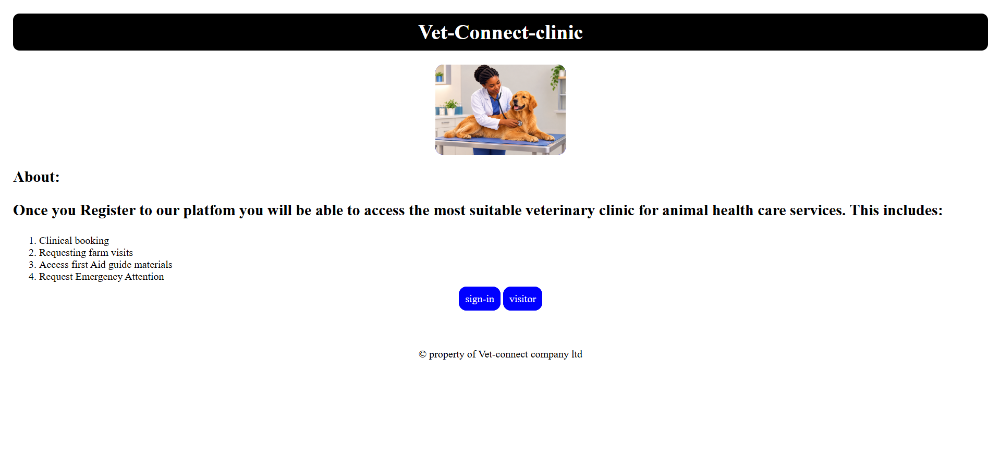
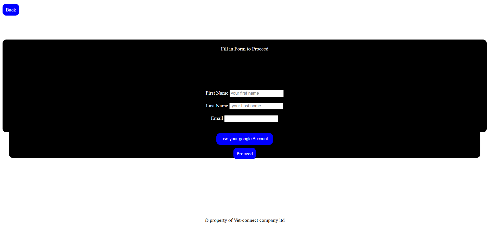
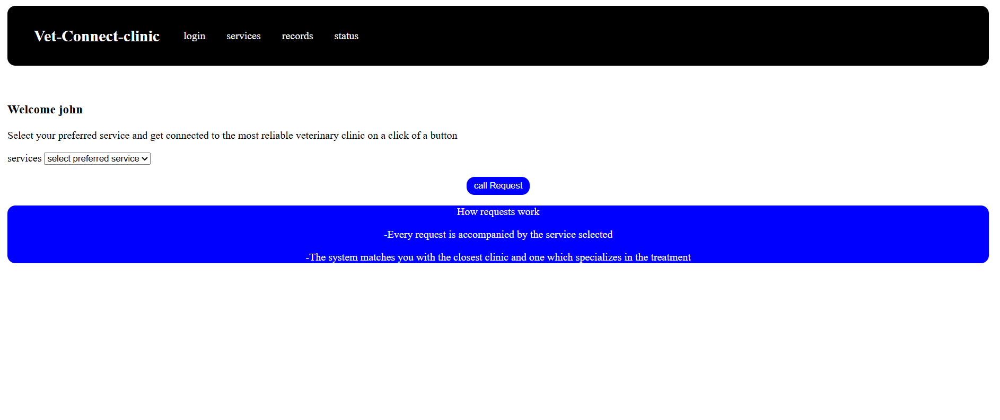
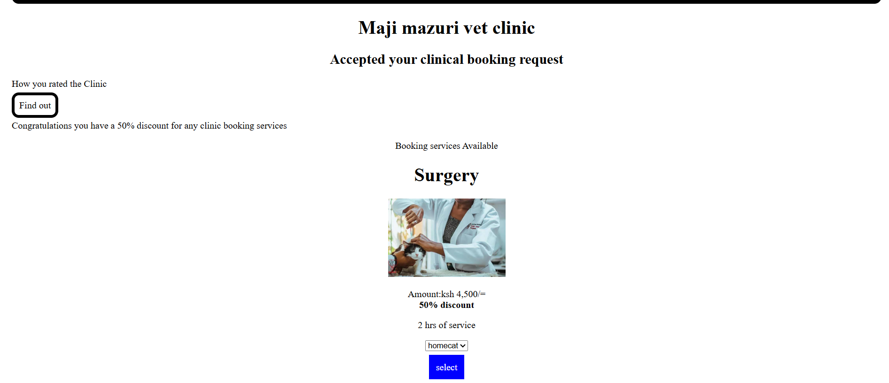
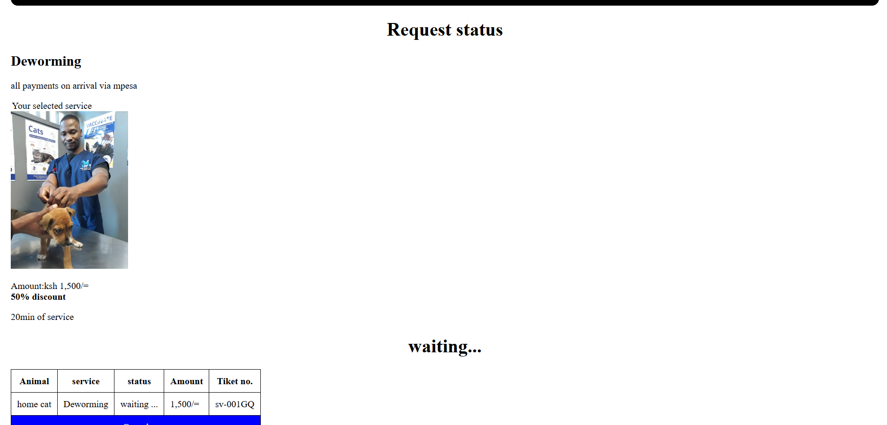
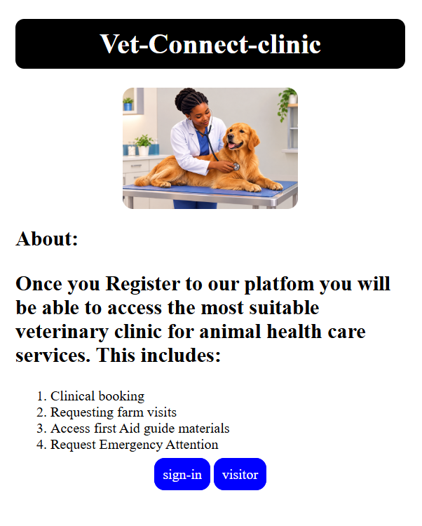

# Vet Connect
## 1.Project Name and Overview

**Vet-Connect Clinic** is a multipage platform where by veterinary clinics are available to clients on a click of a button , once clients register they  can be able to access booking of clinical visits, request a farm  visit , ask for emergency attention and can also track the status of their requests and review their past visits and clinic ratings.

The prototype is built around a sample clinic, **Maji Mazuri Vet Clinic** and shows the full journey from landing page to receiving a ticket number for a booked service.

## 2.Problem Statement

Animal owners the clients find it difficult to find reliable veterinary clinic quickly. Common problems include:
- Not knowing which nearby clinic offers specific treatment their animals require.
- unclear prices hence owners only know price on arrival
- No simple way to request help in an emergency or to ask for a farm visit.
- No record of past visits,treatments or what was paid.
- No way to know whether a booking request was received or accepted.

## 3.Target Audience

**Pet owners** those who own cats,dogs,rabbit and others who want to book clinic services.
**Livestock farmers** who want a farm visit.
**Owners facing an Emergency** who need fast help.
**First-time visitors** who want to browse services before signing in.
**Returning clients** who want to check request status,records and ratings

## 4.Proposed Solution
Vet-Connect Clinic is a simple,mobile-friendly web platform where a user:

1.signs in , or continues as a visitor.

2.Selects the service they need ( clinical booking,farm visit, or emergency).

3.Is matched with the closest and reliable clinic.

4.Sees the services on offer, with the price, duration f service and any discount is shown upfront.

5.picks the animal type and selects a service.

6.Tracks the request on a status with a ticket number.

7.Later reviews their records and the rating they gave the clinic.

## 5.Project Goal

- Make it possible to access veterinary service in a few clicks.
- Show prices and durations clearly before the user commits.
- Give every request a visible status and ticket number.
- Keep a history of past visits and ratings.
- Make it responsive across devices
- Lay a foundation that can later connect to a backend, location matching, and M-pesa payment

## 6.Features

- Welcome page with **sign-in** or **visitors** access
- Sign-in form(first name , last name , email , google account option)
- Service selector:clinical booking, farmvisit, emergency
- personalised greeting on landing page
- Service cards with image,price,discouts if available and duration
- Animal type selector (Cat,dog,rabbit,hamster many more to be added)
- Request status page with a status table and ticket number
- Cancel option on status table
- Records page for completed visits
- Visits history page with a radio rating and users comments and number of visits
- Consistent navigation page on every inner page
- payment note:all payments are payed on arrival via M-pesa

## 7.User Stories
- AS a **pet owner**, I want to view the veterinary services on offer so that i can find the service my animal needs.
- As a **pet owner** , I want to see the actual price and discount for each service so that i know the cost before i book.
- As a **pet owner**, I want to choose the type of animal so that the clinic will know who they will treat.
- As a **farmer**,I want to request a farm visit so that a vet can treat my animals without me transporting them.
- As a **new user** i want to request emergency attention so that my animals get help as fast as possible.

## 8.Pages and How They Link
| Page | What it does | links to |
| ---- | ------------ | -------- |
| `index.html` | Welcome page with  the platform overview,list of what users can do, and two entry button | `sign-in.html` (sign-in), `landingpage.html`(visito) |
| `sign-in.html` | Form for first name, last name, and email, with a Google account button | `index.html` (Back), `landingpage.html` (Proceed) |
| `landingpage.html` | Greets the user, lets them pick a service, and send a "call request" | `accept.html` (request button and Services), `index.html` (login), `records.html`, `status.html` |
| `accept.html` | Shows the clinic that accepted request, shows the 50% discount and the available services, with an animal selector | `status.html` (select), `visits.html` (rate the clinic), nav links |
| `status.html` | Shows the selected service, payment note, and a table with the animal, service, status, amount, and ticket number | nav links |
| `records.html` | Shows completed visit records (currently an empty-state message) | nav links |
| `visits.html` | Shows the user's clinic rating, comment, and visit count | nav links |

## 9.style Guide

### colours
| Use | Colour |
| --- | ------ |
| Navigation bar, brand banner, sign-in form | `Black` |
| Text on dark backgrounds | `White`  |
| Primary buttons, info panel, cancel row | `Blue` |
| Rating accent | Gold (`accent-color: gold`) |
| Page background and body text | `White and black` |

### fonts
- Uses default browser font
- nav brand title is set to `24px`
- Headings (`h1`,`h2`) are centered on every content pages.

### Buttons
- **Primary button (`.next-buttons`):** blue background, white text, 10px solid blue border, `12px` rounded corners, no underline.
- **Form button:** blue background, white text, `12px` rounded corners.

### cards
- Each service is an `<article>` with a heading, image (`200px` wide), price, discount in bold, duration, and an animal selector.
- The "How requests work" box is a blue panel with white text and `12px` rounded corners.
- The brand banner and nav bar use a black border with rounded corners (`10px` and `12px`).

### Statuses
| Status | Where | Appearance |
| ------ |-------| ---------- |
| Waiting | `status.html` heading and table | Plain text: "waiting..." |
| Cancel | `status.html` table row | White text on a blue full-width cell |
| Empty records | `records.html` | Large message: "Oops you have no completed records" |

## 10.Technologies Used
- **HTML5**, with semantic elements (`nav`, `main`, `section`, `article`, `footer`)
- **CSS3**, with Flexbox, @media, borders, and border-radius
- **Git and GitHub** for version control and hosting the repository
- **GitHub Pages** for the live site

## 11.How the site adapts to different Screen Sizes
 - Every page includes `<meta name="viewport" content="width=device-width, initial-scale=1.0">`.
 - The navigation bar uses `display: flex` with `flex-wrap: wrap`.
 - A media query at `max-width: 600px` reduces the nav border from `20px` to `8px`.
 - The status table sits inside a `.table-wrap` container with `overflow-x: auto`,so it swipes horizontally avoiding breaking the page. 
 - Images have a fixed `200px` width, and the hero image has `max-width: 100%` so it never exceeds its container.
 - The body has a `20px` margin to keep content off the screen edges.

 ## 12. Accessibility Considerations
- `lang="en"` is set on every page.
-  Images have `alt` text describing them.
- Form fields use `<label>` elements linked to inputs with `for` and `id`.
- Semantic landmarks (`nav`, `main`, `footer`) help screen-reader users move around the page.
- High contrast between white text and black or blue backgrounds.
-Navigation is consistent across all  pages from landingpage.html.
- Links and buttons have visible text instead of icon-only controls.

## 13. Design Decisions and Why
- **Black and blue** Strong contrast keeps text readable, and blue marks every clickable action so users learn where to click.
- **Same navigation bar on every inner page:** Users always know they have quick access across pages.
- **Simple, short flow:** Select service, request, accept, status. Few steps means fewer places for users to get lost.
- **Prices and discount shown on the card:** Users see the cost before choosing, which builds trust.
- **Visitor option:** People can look around without registering first.
- **Payment on arrival via M-Pesa:** Matches how many local clients prefer to pay and keeps the prototype free of payment logic.
- **Rounded corners (`12px`) on buttons, panels, and nav:** Gives the interface a friendly look suited to an animal-care brand.
- **Plain HTML and CSS only:** Keeps the project easy to host, read, and learn from.

## 14. Challenges
- **Responsive navigation:** Making the nav bar wrap cleanly on small phones took a media query and `flex-wrap`.
- **Wide table on mobile:** The status table overflowed small screens until it was placed in a scrollable wrapper.
- **Footer placement:** The footer was positioned with a fixed offset, which does not suit pages of different lengths.
- **Repeated CSS:** Each page carries its own copy of the nav and footer styles, so one change had to be made seven times.
- **No backend:** Status, tickets, and records are static, so the flow shows how the product will work rather than real data.
- **Keeping the design consistent:** Buttons and cards were styled slightly differently across pages and needed alignment.

## 15. Future Improvements
- [ ] Move shared styles into one `style.css` file
- [ ] Fix footer layout with Flexbox (`min-height: 100vh`)
- [ ] Add a backend, user accounts, and real authentication
- [ ] Match clients to clinics by location
- [ ] Build the farm visit and emergency request flows
- [ ] Add first aid guide pages
- [ ] Integrate M-Pesa payments
- [ ] Add status stages (waiting, accepted, in progress, completed) with colour coding
- [ ] Make records and ratings dynamic
- [ ] Improve accessibility (alt text, focus styles, accessible rating)
- [ ] Set a custom font and a fuller design system

## 16. Screenshots
| Page | Screenshot |
|------|------------|
| Welcome page |  |
| Sign-in |  |
| Landing page |  |
| Services |  |
| Request status |  |
| Mobile view |  |

## 17.Live Site and Repository Links
- **Live site:** (https://noahmuthama.github.io/git_project/)
- **Repository:** (https://github.com/noahmuthama/git_project.git)


### Run locally
```bash  
https://github.com/noahmuthama/git_project.git

cd vet-connect
```
Then open `index.html` in your browser. No installation is needed.

## Author
Noah Kuria, [https://noahmuthama.github.io/git_project/]

&copy; Vet-Connect company ltd. All rights reserved.


